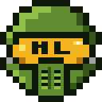

<h1 align="center">Spartan Armory</h1>

Tools for Halo Infinite players, built with a Halo HUD look.

---

## The tools

| | What it is | Status |
| --- | --- | --- |
|  **[Halo Labs](https://halolabs.gg/)** | The home of the tools, at [halolabs.gg](https://halolabs.gg/): a dashboard with accounts, a HUD look in a choice of palettes, and docs for every page. | Live |
| **Halo Stats** | Read from Halo Infinite itself. A player's ranked CSR with Halo's own rank emblems, career and combat figures over any window, best maps and modes, and every ranked match with both teams' scoreboards and medals. Plus **Pro Stats** for the LVT Halo Pro League and **Teams**, pro and community. Part of Halo Labs. | Live |
| **[Sitrep](https://halolabs.gg/tracker/download)** | Formerly Halo Tracker. A Windows overlay on top of Halo Infinite that reads the kill feed (OCR) to show who on each team is alive, dead or respawning. After each match it checks its own count against Halo's scoreboard, and sends the match to Halo Labs. | Live, 1.1 |
| **Sidearm** | A desktop app that records every match the same way for every player, uploads it to Halo Labs and can stream it live. One menu, also driven from a Stream Deck, sets up audio, Discord, monitor and crosshair profiles. Windows first, then macOS and Linux. | In development |
| **War Room** | Match study. Each match's film is decoded into positions, aim and events, and every player's recording is lined up against it, for reviewing your own matches and scouting other teams'. | In development |
| **Spectate** | Live matches on Halo Labs: one player, a 4-up or all eight in sync, with the HUD and scoreboard drawn over them, plus a delayed public feed and rebroadcast. | In development |

## Built with

- **Halo Labs**: React, TanStack Router and Tailwind, with a small Node API on SQLite. Accounts are linked to Xbox, with email sign-in codes. Halo Stats reads Halo Infinite's own services through a linked Xbox account.
- **Sitrep**: C# on Windows' built-in OCR, drawn as a transparent, click-through overlay. It only reads the screen: no memory reading, no input automation, nothing hooked into the game.
- **Sidearm**: a Tauri (Rust) desktop app, recording and streaming on the GPU's own video encoder, with a Stream Deck plugin.
- **War Room**: Python, decoding Halo Infinite's theater films.
- **Spectate**: self-hosted LiveKit (WebRTC), with each player's stream sent in several qualities so every viewer gets the one that fits.

---

Spartan Armory is a fan project. Halo is a trademark of Microsoft; this project isn't affiliated with or endorsed by Microsoft or Halo Studios. Halo Labs is made under Microsoft's Game Content Usage Rules.
