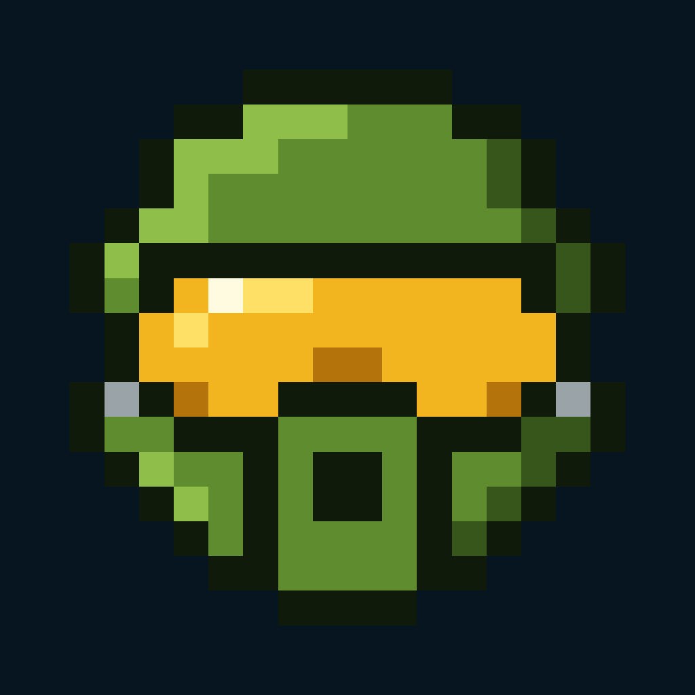

  

<h1 align="center">Spartan Armory</h1>

Tools for Halo Infinite players, built with a Halo HUD look.

---

## The tools

| | What it is | Status |
| --- | --- | --- |
| **[Halo Labs](https://web.bartmatusiak.com/halo/)** | The home of the tools: a dashboard with accounts, a HUD look, and docs for every page. | Live |
| **Halo Stats** | A player's ranked playlists and CSR, lifetime figures (K/D, win rate, accuracy) and searchable match history. Part of Halo Labs. | Live, on sample data |
| **Halo Tracker** | An overlay that sits on top of Halo Infinite and reads the kill feed (OCR) to show who on each team is alive or dead during a match. | Coming soon |

## Built with

- **Halo Labs**: React, TanStack Router, Tailwind; a small Node API on SQLite; email sign-in codes.
- **Halo Tracker**: on-screen OCR of the kill feed, drawn as a transparent overlay.

---

Spartan Armory is a fan project. Halo is a trademark of Microsoft; this project isn't affiliated with or endorsed by Microsoft or Halo Studios.
